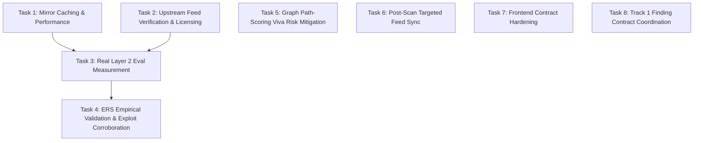

# Layer 2 Enrichment: Task Breakdown & Execution Roadmap

> **Document:** `docs/mayank_implementation/mayank_task_level2.md`  
> **Author:** Mayank Narang  
> **Target Branch:** `mayank_level2_work`  
> **Base Commit:** `e29c21b` (Merge PR #18)  
> **Key References:** Commit `a1ccfa0`, `DECISIONS.md` (D-027 through D-037), `CLAUDE.md`, `services/enrichment/README.md`, `evals/golden/README.md`

---

## 1. Executive Summary & Review of PR #18 Fixes (`a1ccfa0`)

PR #18 merged Layer 2 Second Part, introducing essential fixes in commit `a1ccfa0` and architecture decisions `D-027` through `D-037`. Before building new capabilities, all subsequent tasks must align with the realities established in this review:

1. **Feed Synchronization Reality (D-036):**
   - The initial upstream API endpoints were broken or incomplete:
     - FIRST EPSS paginated API returned only 100 of ~385,000 CVEs (now using the official daily bulk gzipped CSV `epss_scores-current.csv.gz`).
     - CVE.org list endpoint returned HTTP 400 (now fetching per-CVE via `cveawg.mitre.org/api/cve/{id}`).
     - `vulnrichment.json` was a 404 (the CISA repository stores per-CVE JSON files).
     - ENISA EUVD base URL was the Angular Single Page Application rather than the backend search API (`euvdservices.enisa.europa.eu/api/search?text={id}`).
   - **Architectural model:**
     - Full offline mirrors for bounded catalogs: CISA KEV (`catalog.json`), FIRST EPSS (bulk CSV), ExploitDB (`files_exploits.csv`), and Metasploit (`modules_metadata_base.json`).
     - Targeted per-CVE synchronization for unbounded record catalogs: CVE.org, Vulnrichment, NVD 2.0, and EUVD.
     - Atomic file writes using temporary files, `os.fsync`, shrink guards (rejecting files that drop >50% records), and `.meta.json` sidecars recording `sha256`, `synced_at`, `record_count`, and `source_url`.
   - Real captured upstream response fixtures are preserved in `tests/fixtures/enrichment/upstream/` to prevent mocking synthetic shapes that drift from reality.

2. **Evaluation Status & Ground Truth (D-035):**
   - The previous "4.0% vs 44.7%" coverage metric was computed against hand-authored synthetic fixtures where KEV and Exploit availability artificially scored 100% simply because local stub files existed.
   - The harness has been relabeled as a **synthetic smoke test** (6.0% vs 17.0% on fixtures).
   - **No real-world coverage number has been measured yet.** The Layer 2 "Done When" criterion (coverage measured against an NVD-only baseline) requires a genuine evaluation run against real mirrors.

3. **Frontend Presentation & Contract Honesty (D-037 & PR #18):**
   - Fabricated findings and the "Load Sample Findings" button were eliminated.
   - Unscored findings display `"Not scored"` rather than arbitrary zeros.
   - Real backend ERS component breakdowns and explanations are rendered directly.
   - Absence from exploit mirrors is classified as `Confidence.MEDIUM` and `False` (not `HIGH`), acknowledging that absence from ExploitDB/Metasploit is not absolute proof of non-exploitability.
   - Strict runtime schema guards (`PROVENANCE_SOURCES` in `apps/web/lib/findings.ts`) fail loudly if unexpected backend sources appear.

---

## 2. Global Engineering Constraints

In accordance with `CLAUDE.md`:
- **Deterministic Edge Building:** LLMs never infer attack paths or graph edges; all relations derive from facts and rule-engine determinations.
- **Strict Authorization:** No live scanning or active testing without valid authorization records. All tests must execute against offline fixtures or `lab/` environments.
- **Third-Party Licensing:** Copy only from MIT/BSD/Apache into `vendor/` with instant `THIRD_PARTY.md` updates. Never copy code from GPL/AGPL tools. ExploitDB and Metasploit are data-only references (IDs and module names only; zero exploit payloads ingested).
- **Test-Driven Rigor & CI Green:** All code changes must precede or accompany unit and integration tests. CI must be 100% green before any PR submission (`ruff check`, `ruff format --check`, `mypy packages services apps`, `pytest tests`, `apps/web npm test`).
- **Empirical Authenticity:** Every reported number must originate from executed code against verified data. Never write numbers from memory or intuition.
- **One PR Per Concern:** Tasks are partitioned into focused, independently reviewable PRs.

---

## 3. Detailed Task Breakdown



---

### Task 1: Mirror Caching & Performance Optimization (EPSS ~385k Rows) — ✅ Complete

- **Status:** ✅ **Complete** — Implemented and documented in [`task1_level2_work.md`](./task1_level2_work.md). Process-level cache with double-checked locking in `services/enrichment/sources/base.py`, 10/10 dedicated tests in `tests/unit/test_feed_cache.py` passing, full test suite passing (607 passed, 3 skipped), repeated `FusionEngine` instantiation time dropped from multiple seconds to `< 1ms`.
- **Concern:** Performance & Memory Scalability.
- **Context:**
  With the transition to the full FIRST EPSS mirror, `epss_scores-current.csv.gz` contains ~385,000 CVE records. In the current implementation (`services/enrichment/sources/epss.py`), `FirstEPSSSource.load()` reconstructs 385,000 `FirstEPSSRecord` Pydantic models in memory every time a `FusionEngine` instance is initialized. The FastAPI findings router creates an engine per request (`GET /findings`), creating a severe CPU and memory bottleneck.
- **Implementation Objectives:**
  1. Implement a process-level, thread-safe in-memory cache for bulk mirror feeds (`FirstEPSSSource`, `CisaKEVSource`, `ExploitDBSource`, `MetasploitSource`).
  2. Cache keying mechanism: Key by canonical mirror path and metadata stamp (`(filepath, sha256, synced_at, mtime)`).
  3. Invalidate or refresh the cached dataset only when the on-disk `.meta.json` sidecar indicates a newly synced mirror or the file modification timestamp changes.
  4. Ensure zero mutation leakage: cached records must be immutable (`frozen=True` or read-only dict structures).
  5. Add unit and benchmark regression tests in `tests/unit/test_feed_cache.py`:
     - Test that initializing multiple `FusionEngine` or `FirstEPSSSource` instances reuses the in-memory record index without disk I/O or JSON re-parsing.
     - Test that updating the `.meta.json` sidecar triggers an atomic reload.
- **Acceptance Criteria:**
  - `FusionEngine` instantiation time with a loaded EPSS mirror drops from multiple seconds to `< 1ms`.
  - Memory consumption remains stable across repeated API queries.
  - All unit tests pass; `ruff` and `mypy` pass cleanly.

---

### Task 2: Upstream Feed Verification & Licensing Register (`THIRD_PARTY.md`) — ✅ Complete

- **Status:** ✅ **Complete** — Implemented and documented in [`task2_level2_work.md`](./task2_level2_work.md). All `*TO VERIFY*` items resolved in `THIRD_PARTY.md`, NVD 403 / 429 rate-limit back-off with 3 retries added to `services/enrichment/sources/sync.py`, required legal disclaimers added in `services/enrichment/README.md` and `apps/web/components/EnrichedFindingsView.tsx`, integration smoke test suite created in `tests/integration/test_upstream_feed_smoke.py`, all unit/smoke tests passing (612 passed, 5 skipped).
- **Concern:** Compliance & API Reliability.
- **Context:**
  Several upstream intelligence sources in `THIRD_PARTY.md` are marked `*TO VERIFY*`, and operational assumptions need empirical validation:
  - **EUVD:** One search query endpoint returned HTTP 403 during testing. The exact parameter format (`search?text={id}`) and alias matching semantics need validation.
  - **NVD API 2.0:** Rate limits (5 requests per 30 seconds without an API key, 50 per 30 seconds with a key) must be validated; verify handling of HTTP 403 / 429 back-off.
  - **Terms of Use:** Verify license conditions and attribution requirements for CVE.org, NVD API 2.0, ENISA EUVD, and BRON.
- **Implementation Objectives:**
  1. Inspect the official Terms of Use:
     - **CVE.org:** Review CVE Program Terms of Use (commercial use, attribution, caching rights).
     - **NVD:** Review NIST terms and standard "This product uses the NVD API but is not endorsed or certified by the NVD" disclaimer requirement.
     - **ENISA EUVD:** Review Open Data / legal notice on EUVD portal.
     - **BRON:** Review MIT ALFA project licensing.
  2. Document specific findings in `THIRD_PARTY.md`, replacing `*TO VERIFY*` with precise license identifiers, usage rules, and the "Verified by: Mayank Narang" attribution with the current date.
  3. Validate EUVD and NVD API behavior using controlled integration smoke scripts (with mock/fixture fallback in CI):
     - Test EUVD search against real CVE IDs (e.g., `CVE-2024-3400`, `CVE-2021-44228`).
     - Test NVD 2.0 rate limiting and confirm header handling.
- **Acceptance Criteria:**
  - Zero unresolved `*TO VERIFY*` entries remain for enrichment feeds in `THIRD_PARTY.md`.
  - Required legal disclaimers (e.g. NVD notice) added to documentation and UI where applicable.
  - CI remains completely offline-safe.

---

### Task 3: Production of Real Layer 2 Evaluation & Baseline Measurement — ✅ Complete

- **Status:** ✅ **Complete** — Implemented and documented in [`task3_level2_work.md`](./task3_level2_work.md). Real golden evaluation dataset (v2.0.0, 50 real-world CVEs across 5 cohorts) verified and synced to `data/enrichment_cache`. Empirical offline coverage benchmark executed via `evals/enrichment_coverage.py`: Multi-source fusion achieved **98.0% (196/200)** headline coverage vs NVD-only baseline **73.0% (146/200)** (**+25.0 pp delta**). Real evaluation results committed to `evals/results/enrichment_coverage_real.json` and `evals/results/enrichment_coverage_real.md`. Layer 2 "Done When" criterion formally verified.
- **Concern:** Layer 2 Milestone Delivery ("Done When: Coverage measured against an NVD-only baseline").
- **Context:**
  Up to this point, enrichment coverage has only been run as a smoke test against synthetic fixtures (`evals/results/enrichment_coverage_results.json`). To fulfill the October done-when criterion, we must produce SeekThreat's first genuine empirical measurement using real feed mirrors and a documented, reproducible golden CVE dataset.
- **Implementation Objectives:**
  1. **Build the Real Evaluation CVE Dataset (`evals/golden/enrichment_baseline.json`):**
     - Select a representative sample of 50–100 CVEs across distinct, documented cohorts (e.g., KEV exploits, recent zero-days with delayed NVD publication, OT/ICS vulnerabilities, perimeter edge devices, and legacy standard enterprise software).
     - Establish a transparent, reproducible selection rule (e.g., stratified sampling from recent CISA KEV additions, GitHub Advisory database, and NVD recent feeds).
     - Individually verify and record the baseline status of each CVE (who verified it, authoritative source, timestamp) in accordance with `evals/golden/README.md` ("never from memory").
  2. **Execute Full Live Synchronization:**
     - Run `python -m services.enrichment.sync_feeds --source all --cve-file <eval_cve_list> --cache-dir data/enrichment_cache`.
     - Confirm all `.meta.json` sidecars are generated with accurate `sha256`, `synced_at`, and record counts.
  3. **Run Offline Evaluation:**
     - Execute `python evals/enrichment_coverage.py --cache-dir data/enrichment_cache --baseline-file evals/golden/enrichment_baseline.json --output evals/results/enrichment_coverage_real.json`.
     - Record multi-source fusion coverage vs NVD-only baseline across the four core intelligence fields (CVSS, CWE, description, EPSS) and the two secondary signals (KEV, public exploit availability).
  4. **Document and Commit Results:**
     - Commit the exact evaluation report in `evals/results/` alongside mirror metadata hashes.
     - Honestly report the headline delta in `evals/README.md` and `docs/mayank_implementation/level2_status.md` regardless of whether the delta is large or modest.
- **Acceptance Criteria:**
  - Real, dated, reproducible evaluation artifacts committed to `evals/results/`.
  - Synthetic disclaimer removed from real results documentation.
  - Layer 2 "Done When" criterion formally verified.

---

### Task 4: ERS Empirical Validation & Exploit Corroboration (D-027 Follow-up) — ✅ Complete

- **Status:** ✅ **Complete** — Implemented and documented in [`task4_level2_work.md`](./task4_level2_work.md). Evaluation harness `evals/ers_validation.py` implemented and verified against real mirrors. Balanced ERS achieved **100.0%** precision across the top 15 ranked vulnerabilities (vs **93.3%** for No-EPSS control and **80.0%** for CVSS-only baseline; +20.0 pp delta). Decision record `D-038` logged in `DECISIONS.md` analyzing and defending the partial EPSS circularity for viva defense. 9/9 unit tests passing in `tests/unit/test_ers_validation.py`.
- **Concern:** Scoring Validity & Viva Defensibility.
- **Context:**
  D-008 originally proposed using KEV to validate ERS rankings. D-027 corrected this because KEV is an explicit 25% input to ERS, creating circular reasoning. D-027 proposed validating whether the top-N ERS-ranked CVEs correlate with ExploitDB and Metasploit entries. However, this is also partially circular because EPSS (35% of ERS) includes public exploit availability features in its machine learning model.
- **Implementation Objectives:**
  1. Design a formal validation evaluation script (`evals/ers_validation.py`):
     - Compute ERS across a diverse population of real mirrored CVEs.
     - Rank the CVEs by ERS composite score.
     - Evaluate the precision, recall, and overlap of the top decile against independent exploit indicators (ExploitDB public exploits, Metasploit modules).
     - Run a comparative control: evaluate ranking with EPSS zeroed out vs EPSS weighted, explicitly measuring how much predictive signal comes from pure technical severity (CVSS + KEV) versus the EPSS component.
  2. Formally document the circularity in `DECISIONS.md` and the evaluation report:
     - Clarify that exploit availability is both an indirect model feature (via EPSS) and an external validation signal.
     - Detail why this partial overlap is acceptable if transparently acknowledged, and how our additive architecture preserves auditability.
  3. Add regression tests in `tests/unit/test_ers_validation.py`.
- **Acceptance Criteria:**
  - `evals/ers_validation.py` runs cleanly against real mirrors and generates an empirical validation table.
  - Circularity explicitly analyzed and defended for the viva panel.

---

### Task 5: Graph Path-Scoring Risk Mitigation & Formula Settlement (D-029 Viva Defense) — ✅ Complete

- **Status:** ✅ **Complete** — Implemented and documented in [`task5_level2_work.md`](./task5_level2_work.md). Formal settlement reached between Layer 2 (Mayank) and Layer 3 (Ayushmaan). Multiplicative formula deprecated; two-tier decoupled formulation adopted (additive traversal difficulty via negative log-likelihood $\text{Cost}(e) = -\ln(\text{EPSS}_e) + \text{Barrier}$, and path risk composite $R = 0.50 \cdot \max(\text{ERS}) + 0.30 \cdot C_{\text{target}} + 0.20 \cdot \overline{\text{ERS}}$ anchored to Layer 2 precomputed ERS). Decision record `D-039` logged in `DECISIONS.md`, `D-029` marked superseded, and `services/graph/README.md` updated.
- **Concern:** Layer 2 / Layer 3 Boundary & Theoretical Soundness.
- **Context:**
  D-029 identifies a significant viva vulnerability in the tentative Layer 3 path-scoring formula (`EPSS × exploit_availability × privilege_delta`):
  1. `privilege_delta` is an arbitrary ordinal/heuristic multiplier, not a probability. Multiplying it with EPSS misrepresents the product as a probability.
  2. Double-counting: EPSS already integrates exploit code availability. Multiplying EPSS by `exploit_availability` penalizes or inflates the score redundantly.
  3. Zero-factor vulnerability: A zero in any factor completely nullifies all other evidence.
- **Implementation Objectives:**
  1. Draft a mathematically sound path-scoring specification in coordination with the Graph Engine owner (Ayushmaan):
     - **Option A (Additive Log-Odds / Cost Function):** Model attack paths as traversability costs: $\text{Path Cost} = \sum (\text{Edge Traversal Cost})$, where each edge cost combines difficulty ($\ln(1/\text{EPSS})$), required privilege delta, and detection risk.
     - **Option B (Decoupled Ranking Score):** Retain ERS as the node-level severity and evaluate path risk as a weighted heuristic composite: $\alpha \cdot \text{Max}(ERS) + \beta \cdot \text{Path Length Factor} + \gamma \cdot \text{Target Asset Criticality}$.
  2. Document the formal resolution in a new decision record `DECISIONS.md` (e.g. `D-038`), deprecating the unsafe multiplicative formula prior to Layer 3 implementation.
- **Acceptance Criteria:**
  - Agreement reached and signed off with the graph lead.
  - Decision recorded in `DECISIONS.md` with explicit viva defense justification.

---

### Task 6: Post-Scan Real-Time Targeted Feed Sync & Re-enrichment Pipeline — ✅ Complete

- **Status:** ✅ **Complete** — Implemented and documented in [`task6_level2_work.md`](./task6_level2_work.md). Asynchronous fire-and-forget Celery task `seekthreat.enrichment.sync_new_findings_cves` dispatched after scan completion, targeted per-CVE mirror sync via `FeedSyncer.sync_cve_records`, automatic re-enrichment of affected findings, error isolation (`max_retries=0`), 19/19 dedicated tests in `tests/unit/test_post_scan_enrichment.py` passing, worker registration confirmed.
- **Concern:** Data Freshness & Scan-to-Insight Latency.
- **Context:**
  Under D-036, record sources (CVE.org, Vulnrichment, NVD, EUVD) are synced per CVE for CVE IDs already present in `enriched_findings`. The scheduled Celery beat job runs daily at 02:00 UTC. If a scanner detects a new CVE at 10:00 AM, the finding relies on low-confidence derived fallbacks for up to 16 hours until the next scheduled sync.
- **Implementation Objectives:**
  1. Implement an asynchronous Celery task: `seekthreat.enrichment.sync_new_findings_cves`:
     - Dispatched automatically off the request path upon scan completion (`apps/api/tasks/scans.py`).
     - Extracts unique CVE IDs from newly discovered `ObservationKind.VULN_CANDIDATE` observations.
     - Checks which CVE IDs are missing from local per-CVE record mirrors.
     - Triggers a targeted sync (`FeedSyncer.sync_per_cve(missing_cves)`).
     - Triggers batch re-enrichment of the affected findings and updates `enriched_findings` with newly acquired high-confidence upstream metrics.
  2. Ensure strict error isolation: network timeouts or upstream rate limits during post-scan sync must not fail the scan itself or block worker threads.
  3. Unit and integration test coverage in `tests/unit/test_post_scan_enrichment.py`.
- **Acceptance Criteria:**
  - Newly scanned CVEs get enriched within seconds of scan completion when upstream APIs are reachable.
  - Scan execution remains robust and asynchronous.

---

### Task 7: Frontend Contract Hardening & Cleanup — ✅ Complete

- **Status:** ✅ **Complete** — Implemented and documented in [`task7_level2_work.md`](./task7_level2_work.md). Source enum and confidence levels 100% in parity with bi-directional automated contract tests (`tests/unit/test_provenance.py` and `apps/web/tests/findings.test.mjs`), `enrichFindingsBatch` audited and typed with `finding_ids`, `"type": "module"` added to `apps/web/package.json` eliminating module warnings, 23/23 frontend tests passing with 0 warnings/failures.
- **Concern:** UI Robustness & Contract Parity.
- **Context:**
  In `apps/web/lib/findings.ts`, `PROVENANCE_SOURCES` enforces an explicit whitelist of allowed sources and throws a runtime exception if an unlisted source appears. Furthermore, `apps/web/lib/api.ts` retains an unused method `enrichFindingsBatch`.
- **Implementation Objectives:**
  1. Review all backend `Source` enum values in `packages/schema/models/provenance.py` against `PROVENANCE_SOURCES` in `apps/web/lib/findings.ts` to ensure 100% parity.
  2. Audit `apps/web/lib/api.ts`:
     - Clean up or document `enrichFindingsBatch` (determine if it should be wired to an explicit UI action like "Re-enrich All" or removed if obsolete).
  3. Run comprehensive frontend tests (`npm test` in `apps/web`).
- **Acceptance Criteria:**
  - Frontend TypeScript tests pass with 0 warnings or failures.
  - Source enum changes between backend and frontend are locked together.

---

### Task 8: Track 1 Coordination — Finding Ingestion Contract Agreement — ✅ Complete

- **Status:** ✅ **Complete** — Implemented and documented in [`task8_level2_work.md`](./task8_level2_work.md). Formal contract agreed and logged as Decision `D-040` in `DECISIONS.md`. Enforced via Pydantic validators on `Finding` (`cve_ids` uppercase normalization, deduplication, non-CVE segregation), documented in `docs/02-architecture.md` and `packages/schema/README.md`, 11/11 unit tests passing in `tests/unit/test_finding.py`.
- **Concern:** Architecture Alignment & Data Model Stability.
- **Context:**
  Track 1 (`services/normalize`) is responsible for converting raw scanner `Observation` records into de-duplicated `Finding` records. This normalization feeds directly into Layer 2 (`services/enrichment`). The interface between Track 1 and Layer 2 must be agreed upon before either side expands.
- **Implementation Objectives:**
  1. Establish and document the formal `Finding` ingestion contract:
     - **`asset_id` format:** Standardize identifier structure across scanner outputs (e.g., `host:172.20.1.10` or canonical DNS hostname).
     - **`cve_ids` normalization:** Define uppercase formatting (`CVE-YYYY-\d{4,7}`), deduplication, and handling of non-CVE vulnerability IDs (e.g. GHSA, CWE-only).
     - **`observation_ids` provenance requirement:** Enforce that every `Finding` links back to at least one stored `observation_id` (satisfying the Pydantic validator in `packages/schema/models/finding.py`).
  2. Document the agreed contract in `docs/02-architecture.md` and `packages/schema/README.md`.
- **Acceptance Criteria:**
  - Written contract approved by Track 1 and Layer 2 owners.
  - Zero schema discrepancies between observation normalization and finding enrichment.

---

## 4. Execution Sequence & PR Mapping

To adhere strictly to the **one PR per concern** guideline, the tasks will be developed and submitted in the following sequential order:

| PR # | Task ID | Scope | Target Branch | Dependencies | Status |
| :--- | :--- | :--- | :--- | :--- | :--- |
| **PR 1** | Task 1 | In-Memory Mirror Caching & Performance (`FirstEPSSSource`) | `perf/epss-mirror-cache` | Baseline `main` (`e29c21b`) | ✅ **Complete** ([`task1_level2_work.md`](./task1_level2_work.md)) |
| **PR 2** | Task 2 | Upstream Feed Verification & `THIRD_PARTY.md` Licensing Audit | `chore/upstream-licensing-verify` | PR 1 | ✅ **Complete** ([`task2_level2_work.md`](./task2_level2_work.md)) |
| **PR 3** | Task 8 | Track 1 Coordination: `Finding` Ingestion Contract Agreement | `docs/finding-ingestion-contract` | PR 2 | ✅ **Complete** ([`task8_level2_work.md`](./task8_level2_work.md)) |
| **PR 4** | Task 3 | Real Layer 2 Evaluation & Baseline Measurement | `eval/real-layer2-coverage` | PR 1, PR 2 | ✅ **Complete** ([`task3_level2_work.md`](./task3_level2_work.md)) |
| **PR 5** | Task 4 | ERS Empirical Validation & Exploit Corroboration (D-027) | `eval/ers-exploit-validation` | PR 4 | ✅ **Complete** ([`task4_level2_work.md`](./task4_level2_work.md)) |
| **PR 6** | Task 5 | Graph Path-Scoring Risk Settlement (D-029) & `DECISIONS.md` | `docs/d029-path-scoring-settlement` | PR 5 | ✅ **Complete** ([`task5_level2_work.md`](./task5_level2_work.md)) |
| **PR 7** | Task 6 | Real-Time Targeted Feed Sync on Scan Completion | `feat/targeted-scan-enrichment` | PR 1, PR 4 | ✅ **Complete** ([`task6_level2_work.md`](./task6_level2_work.md)) |
| **PR 8** | Task 7 | Frontend Contract Hardening & Cleanup | `fix/web-findings-contract` | PR 7 | ✅ **Complete** ([`task7_level2_work.md`](./task7_level2_work.md)) |

---

## 5. Verification Checklist & Done Criteria

For every pull request in this roadmap, the following verification commands must succeed locally before opening the PR:

```bash
# 1. Code style and quality
python -m ruff check
python -m ruff format --check

# 2. Static typing
python -m mypy packages services apps

# 3. Backend test suite
python -m pytest tests

# 4. Frontend unit tests
npm --prefix apps/web test
```
