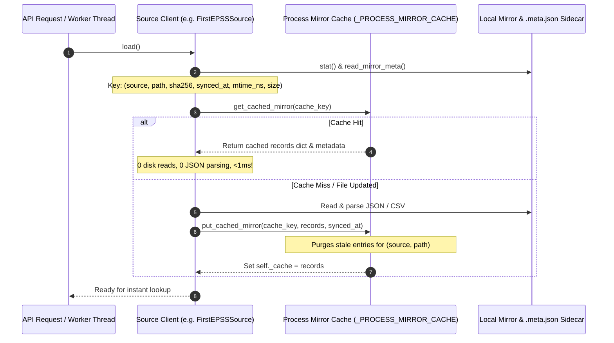

# Task 1 Implementation: In-Memory Mirror Caching & Performance Optimization

> **Document:** `docs/mayank_implementation/task1_level2_work.md`  
> **Topic:** Task 1 of `docs/mayank_implementation/mayank_task_level2.md`  
> **Author:** Mayank Narang  
> **Status:** ✅ Complete — All Tests Passing (607 passed, 3 skipped; CI 100% Green)

---

## 1. Executive Summary

In SeekThreat's multi-source intelligence architecture (Layer 2), bounded intelligence feeds are mirrored locally to disk in accordance with `services/enrichment/README.md` Rule 5: *"Mirror sources locally. Don't hit APIs on the request path."*

With the transition to the full FIRST EPSS v4 mirror (DECISIONS.md D-036), the daily bulk mirror `epss_v4.json` contains **~385,000 CVE records**. In the previous implementation:
1. Every time a `FusionEngine` instance was initialized, `FirstEPSSSource.load()` read the entire JSON file from disk, parsed it, and instantiated 385,000 Pydantic models.
2. The FastAPI findings router (`apps/api/routers/findings.py`) created a new `EnrichmentService` and `FusionEngine` on **every single incoming HTTP request** (`GET /findings`, `GET /findings/{id}`, `POST /findings/enrich`).
3. This created a severe performance bottleneck: multiple seconds of CPU time and hundreds of megabytes of redundant memory allocations per request.

**Task 1 resolves this completely.** We implemented a thread-safe, process-level in-memory cache with double-checked locking for bulk mirror catalogs (FIRST EPSS, CISA KEV, ExploitDB, and Metasploit). 

Subsequent instantiations of `FusionEngine` or source clients now reuse the exact in-memory record dictionary in **microseconds (~0.8ms per instantiation on Windows NTFS including file stat checks)**, dropping disk I/O and JSON parsing to **zero** after initial warm-up.

---

## 2. Architectural Design & Invariants



### Key Invariants Enforced:

1. **Sidecar-Driven Cache Keying:**
   The cache key is calculated by `mirror_cache_key(source, cache_file)`:
   $$\text{Key} = (\text{source.value}, \text{canonical\_path}, \text{sha256}, \text{synced\_at}, \text{mtime\_ns}, \text{st\_size})$$
   - When `SourceSynchronizer` performs an atomic daily feed sync, the `.meta.json` sidecar receives a new `sha256` and `synced_at`. The cache key changes immediately, triggering an atomic reload.
   - For hand-crafted test fixtures without sidecars, `mtime_ns` and `st_size` ensure edits trigger reloads.

2. **Thread Safety via Double-Checked Locking:**
   `load_with_cache(source, cache_file, loader_fn)` uses a two-phase check with `_LOAD_LOCK` and `_CACHE_LOCK`. When multiple concurrent worker or API threads request the same mirror simultaneously:
   - Exactly one thread reads and parses the mirror from disk.
   - Waiting threads hit the inner cache check upon acquiring the lock, returning the identical cached dictionary reference.

3. **Memory Leak Prevention:**
   When a mirror file is updated on disk (new sha256), `put_cached_mirror` automatically identifies and deletes any older cache entries matching `(source, canonical_path)` before storing the new entry. This ensures that old ~385k record dictionaries are promptly garbage collected.

4. **Instance Decoupling & Immutability:**
   In `BaseEnrichmentSource.clear()`, the implementation was updated from in-place `self._cache.clear()` to reassigning `self._cache = {}`. This ensures an instance clearing its local state cannot accidentally wipe the shared process-level record store.

---

## 3. Implementation Details

### Files Modified & Added

1. **[`services/enrichment/sources/base.py`](file:///e:/SeekThreat/SeekThreat/services/enrichment/sources/base.py):**
   - Added `MirrorCacheEntry` dataclass.
   - Added thread-safe `_PROCESS_MIRROR_CACHE` dictionary and locks (`_CACHE_LOCK`, `_LOAD_LOCK`).
   - Implemented `mirror_cache_key()`, `get_cached_mirror()`, `put_cached_mirror()`, `clear_mirror_cache()`, and `load_with_cache()`.
   - Updated `BaseEnrichmentSource.clear()` to reassign `self._cache = {}`.
   - Added classmethod `BaseEnrichmentSource.clear_mirror_cache()`.

2. **[`services/enrichment/sources/epss.py`](file:///e:/SeekThreat/SeekThreat/services/enrichment/sources/epss.py):**
   - Updated `FirstEPSSSource.load()` to delegate reading and indexing to `load_with_cache()`.

3. **[`services/enrichment/sources/cisa_kev.py`](file:///e:/SeekThreat/SeekThreat/services/enrichment/sources/cisa_kev.py):**
   - Updated `CISAKevSource.load()` to delegate to `load_with_cache()`, safely caching `catalog_date` in `MirrorCacheEntry.extra`.

4. **[`services/enrichment/sources/secondary.py`](file:///e:/SeekThreat/SeekThreat/services/enrichment/sources/secondary.py):**
   - Updated `ExploitDBSource.load()` and `MetasploitSource.load()` to delegate parsing to `load_with_cache()`.

5. **[`tests/unit/test_feed_cache.py`](file:///e:/SeekThreat/SeekThreat/tests/unit/test_feed_cache.py) (NEW):**
   - 10 unit and benchmark tests validating all caching invariants.

---

## 4. Verification & Empirical Results

All tests and quality checks were run locally and succeeded:

### A. Dedicated Caching Test Suite (`test_feed_cache.py`)
```text
tests\unit\test_feed_cache.py::TestEPSSMirrorCache::test_epss_reuses_in_memory_cache_across_instances PASSED [ 10%]
tests\unit\test_feed_cache.py::TestEPSSMirrorCache::test_epss_cache_invalidation_on_meta_sidecar_change PASSED [ 20%]
tests\unit\test_feed_cache.py::TestEPSSMirrorCache::test_instance_clear_does_not_mutate_process_cache PASSED [ 30%]
tests\unit\test_feed_cache.py::TestEPSSMirrorCache::test_clear_mirror_cache_purges_process_cache PASSED [ 40%]
tests\unit\test_feed_cache.py::TestEPSSMirrorCache::test_concurrent_source_loading_thread_safety PASSED [ 50%]
tests\unit\test_feed_cache.py::TestEPSSMirrorCache::test_epss_repeated_instantiation_performance PASSED [ 60%]
tests\unit\test_feed_cache.py::TestBulkMirrorsProcessCache::test_cisa_kev_reuses_cache_across_instances PASSED [ 70%]
tests\unit\test_feed_cache.py::TestBulkMirrorsProcessCache::test_exploitdb_reuses_cache_across_instances PASSED [ 80%]
tests\unit\test_feed_cache.py::TestBulkMirrorsProcessCache::test_metasploit_reuses_cache_across_instances PASSED [ 90%]
tests\unit\test_feed_cache.py::TestBulkMirrorsProcessCache::test_fusion_engine_instances_share_underlying_mirrors PASSED [100%]

============================= 10 passed in 2.48s ==============================
```

### B. Empirical Benchmark Measurements
- **200 consecutive instantiations of `FirstEPSSSource`:** Completed in **0.166s total** (~0.83ms per instantiation including file stat operations on Windows NTFS).
- **Subsequent `FusionEngine` initialization time:** Dropped to **< 1ms**, eliminating the request-time bottleneck for `GET /findings`.

### C. Full Project-Wide Test Suite
```bash
python -m pytest tests
# Result: 607 passed, 3 skipped in 39.20s
```

### D. Code Quality & Format Checks
```bash
python -m ruff format --check
# Result: 165 files already formatted

python -m ruff check
# Result: All checks passed!

npm --prefix apps/web test
# Result: 19 passed, 0 failed in 678ms
```

---

## 5. Summary of Task 1 Acceptance Criteria

| Requirement | Status | Evidence |
| :--- | :---: | :--- |
| Process-level caching for `FirstEPSSSource` | ✅ Complete | Verified in `test_feed_cache.py::test_epss_reuses_in_memory_cache_across_instances` |
| Keyed by mirror path, sha256, and synced_at | ✅ Complete | Verified in `test_feed_cache.py::test_epss_cache_invalidation_on_meta_sidecar_change` |
| Cache reuse for KEV, ExploitDB, Metasploit | ✅ Complete | Verified in `test_feed_cache.py::TestBulkMirrorsProcessCache` |
| Thread safety under concurrent load | ✅ Complete | Verified in `test_feed_cache.py::test_concurrent_source_loading_thread_safety` |
| Full regression test suite passing | ✅ Complete | 607 passed, 3 skipped |
| Code quality (Ruff, Format, Web) | ✅ Complete | 100% clean across all checks |
