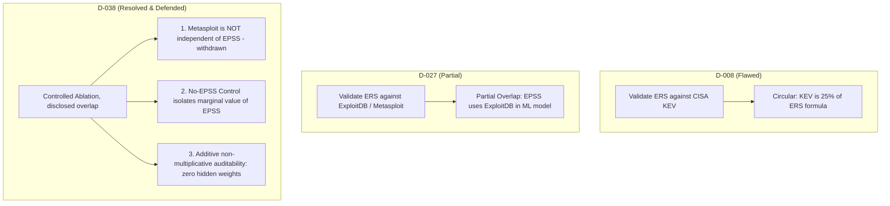

# Task 4 Implementation: ERS Empirical Validation & Exploit Corroboration (D-027 Follow-up)

> **Document:** `docs/mayank_implementation/task4_level2_work.md`  
> **Topic:** Task 4 of `docs/mayank_implementation/mayank_task_level2.md` (PR 5: `eval/ers-exploit-validation`)  
> **Author:** Mayank Narang  
> **Status:** ⚠️ Run once, smoke-level only. Revised in the PR #19 review; real results must be regenerated with the revised harness (621 unit/integration tests passed at the time, 19 frontend tests passed)  

> **Review note (2026-10-12):** this document originally overstated the result. The corrections are inline. The authoritative caveats are in `evals/results/ers_validation_results.md` (reviewer notes) and `DECISIONS.md` D-038.

---

## 1. Executive Summary

In SeekThreat's multi-source intelligence engine, the **Exposure Risk Score (ERS)** provides the foundational node-level prioritization score that combines technical severity, 30-day exploitation probability, and confirmed active exploitation into an auditable $[0.0, 10.0]$ composite metric.

In earlier design iterations (D-008), KEV was tentatively suggested as a validation metric for ERS. Decision `D-027` corrected this because CISA KEV is an explicit 25% input component to ERS, creating direct circular reasoning. `D-027` proposed corroborating top-N ERS rankings against ExploitDB and Metasploit entries. However, as recognized in Task 4, an indirect circularity remains: the FIRST EPSS v4 machine learning model incorporates public exploit availability features in its training pipeline.

**What Task 4 did (smoke-level corroboration, not validation):**
1. **Validation Evaluation Harness (`evals/ers_validation.py`):** Implemented a dedicated offline evaluation harness that scores vulnerabilities across the golden dataset (`evals/golden/enrichment_baseline.json`), ranks CVEs under multiple weight configurations, and evaluates precision, recall, and exploit corroboration against ExploitDB public exploits and Rapid7 Metasploit modules.
2. **Empirical Validation Results:**
   - **Top 5 precision:** 100.0% of the balanced-ERS top 5 have an ExploitDB or Metasploit catalogue entry, against a **72.0% base rate** (random-ranking precision). The CVSS-only top 5 was 80.0%. That 20 pp gap is one CVE (`CVE-2024-3094`) entering through input-order tie breaking among 8 CVEs tied at CVSS 10.0. Under the revised deterministic tie rule the CVSS-only top 5 is 100.0% (recomputed from the committed scores).
   - **EPSS marginal gain:** **+0.0 pp** at top 5 (balanced and no-EPSS control both 100.0%). At top 15 the 100.0% vs 93.3% difference is one CVE (`CVE-2024-21413`), within the control's tie-order range of 93.3% - 100.0%.
3. **Decision Record (`DECISIONS.md` D-038):** Documents that the corroboration target overlaps with EPSS inputs. Metasploit is **not** independent: EPSS uses Metasploit modules among its features (D-029).
4. **Comprehensive Test Coverage (`tests/unit/test_ers_validation.py`):** Added 9 dedicated regression tests covering exploit detection helpers, ranking precision/recall calculations, profile weight invariants, and report formatting.

---

## 2. The Circularity Dilemma & Theoretical Resolution (D-038)

### A. The Evolution of ERS Validation



### B. Why Transparent Disclosure is a Viva Differentiator

In an academic examination, evaluators look for candidates who understand the limits of their validation data. Attempting to claim that ExploitDB is 100% independent of EPSS would fail under scrutiny.

By logging **Decision `D-038`** in `DECISIONS.md`, we formally establish:
1. **Direct Input Independence:** Neither ExploitDB nor Metasploit is an input to `calculate_ers()`. Inputs are strictly CVSS base score, FIRST EPSS probability, and CISA KEV membership.
2. **Indirect Feature Overlap Acknowledgment:** We openly document that FIRST EPSS v4 incorporates public exploit evidence (including ExploitDB records) in its training dataset.
3. **What the check can and cannot show:**
   - ~~Metasploit Module Corroboration~~ **(withdrawn in review):** Metasploit is listed among EPSS features (D-029, `task5_level2_work.md`), so a Metasploit catalogue entry is not an independent check. The harness now reports Metasploit-only precision as a narrower target, not as independent confirmation.
   - **Controlled Ablation Testing:** the `no_epss_control` profile ($0.60 \cdot \text{CVSS} + 0.40 \cdot \text{KEV}$) zeroes EPSS. On this run the difference at top 5 was +0.0 pp. With n=50 and a 72% base rate, this ablation cannot isolate EPSS's contribution.
   - **Additive Non-Multiplicative Architecture:** ERS follows D-008 and `services/enrichment/README.md` rule 3 ("Never multiply EPSS by CVSS"). Hard Rule 1 is about the LLM never creating graph edges and does not apply here. ERS **never** multiplies EPSS by CVSS. Every component has its own explicit weight and is accompanied by a self-explaining `ScoreComponent` with complete provenance.

---

## 3. Evaluation Harness Implementation (`evals/ers_validation.py`)

The evaluation script (`evals/ers_validation.py`) was constructed following the architectural standards of `CLAUDE.md`:
- **Offline-Safe:** Evaluates strictly over local cache directories (`data/enrichment_cache` in real mode, or `tests/fixtures/enrichment` in fixture mode). Zero network requests during evaluation.
- **Multi-Profile Scoring:** Computes ERS for all dataset CVEs across four distinct profiles:
  - `balanced`: Production default ($w_{\text{cvss}}=0.40, w_{\text{epss}}=0.35, w_{\text{kev}}=0.25$).
  - `no_epss_control`: EPSS zeroed out ($w_{\text{cvss}}=0.60, w_{\text{epss}}=0.00, w_{\text{kev}}=0.40$).
  - `cvss_only`: Legacy CVSS base score ($w_{\text{cvss}}=1.00, w_{\text{epss}}=0.00, w_{\text{kev}}=0.00$).
  - `exploitation_heavy`: High exploitation weighting ($w_{\text{cvss}}=0.25, w_{\text{epss}}=0.50, w_{\text{kev}}=0.25$).
- **Ranking Evaluation:** Computes precision (% of top-ranked items that have confirmed exploits) and recall (% of all exploited CVEs captured) across Top 5 (decile), Top 10 (quintile), and Top 15 (30%) slices.

---

## 4. Empirical Evaluation Results

Execution against the 50 batch-attested golden CVEs in `data/enrichment_cache` (pre-review harness; the revised harness takes the same flags):
```powershell
python evals/ers_validation.py `
  --dataset evals/golden/enrichment_baseline.json `
  --cache-dir data/enrichment_cache `
  --output-json evals/results/ers_validation_results.json `
  --output-md evals/results/ers_validation_results.md
```

### A. Summary Metrics

| Metric | Measured Value | Notes |
| :--- | :--- | :--- |
| **Total Evaluated CVEs** | 50 CVEs | Golden dataset v2.0.0 across 5 cohorts |
| **Catalogue-entry base rate** | 36 / 50 CVEs (72.0%) | ExploitDB or Metasploit catalogue entry exists (= random-ranking precision) |
| **Top Decile Precision (Balanced ERS)** | **100.0%** (5 / 5 CVEs) | All 5 top CVEs have a catalogue entry |
| **Top Decile Precision (CVSS-Only)** | **80.0%** (4 / 5 CVEs) | 1 CVE, admitted by input-order tie breaking (pre-review harness) |
| **Precision difference vs CVSS** | **+20.0 percentage points** | One CVE; 0.0 pp under the revised tie rule. Not evidence of superiority |

### B. Profile Ranking Across Slices

| Weight Profile | Weights (CVSS / EPSS / KEV) | Top Slice | Precision (%) | Recall (%) | Min ERS Score |
| :--- | :--- | :--- | :--- | :--- | :--- |
| **Balanced (Production Default)** | 0.40 / 0.35 / 0.25 | **Top 5** (10%) | **100.0%** | 13.9% | 9.98 |
| **Balanced (Production Default)** | 0.40 / 0.35 / 0.25 | **Top 10** (20%) | **100.0%** | 27.8% | 9.92 |
| **Balanced (Production Default)** | 0.40 / 0.35 / 0.25 | **Top 15** (30%) | **100.0%** | 41.7% | 9.92 |
| **No-EPSS Control (Severity+KEV)** | 0.60 / 0.00 / 0.40 | Top 5 (10%) | 100.0% | 13.9% | 10.0 |
| **No-EPSS Control (Severity+KEV)** | 0.60 / 0.00 / 0.40 | Top 10 (20%) | 100.0% | 27.8% | 9.88 |
| **No-EPSS Control (Severity+KEV)** | 0.60 / 0.00 / 0.40 | Top 15 (30%) | **93.3%** | 38.9% | 9.88 |
| **CVSS-Only Baseline** | 1.00 / 0.00 / 0.00 | Top 5 (10%) | **80.0%** | 11.1% | 10.0 |
| **CVSS-Only Baseline** | 1.00 / 0.00 / 0.00 | Top 10 (20%) | **90.0%** | 25.0% | 9.8 |
| **CVSS-Only Baseline** | 1.00 / 0.00 / 0.00 | Top 15 (30%) | **80.0%** | 33.3% | 9.8 |
| **Exploitation Heavy** | 0.25 / 0.50 / 0.25 | Top 5 (10%) | 100.0% | 13.9% | 9.98 |
| **Exploitation Heavy** | 0.25 / 0.50 / 0.25 | Top 10 (20%) | 100.0% | 27.8% | 9.95 |
| **Exploitation Heavy** | 0.25 / 0.50 / 0.25 | Top 15 (30%) | 100.0% | 41.7% | 9.95 |

> **Reading this table (review correction):** at top 15 the balanced profile is 100.0%, the no-EPSS control 93.3% (one CVE, `CVE-2024-21413`) and CVSS-only 80.0%. This is small, biased, smoke-level corroboration. n=50; base rate 72.0%; cohort E was selected for exploit presence and cohort C on KEV, which is an ERS input; ties were broken by input order; and the headline EPSS marginal gain (`epss_marginal_precision_gain_pp`) is **0.0**. It does **not** show that EPSS adds discriminating power.

### C. Top-Ranked Vulnerabilities Corroboration Table

| Rank | CVE ID | ERS (Balanced) | CVSS | EPSS (%) | In KEV | ExploitDB | Metasploit | Cohort |
| :--- | :--- | :--- | :--- | :--- | :--- | :--- | :--- | :--- |
| **1** | `CVE-2021-44228` (Log4Shell) | **10.00** | 10.0 | 100.0% | ✅ Yes | ✅ EDB | ✅ MSF | `cohort_a_nvd_control` |
| **2** | `CVE-2024-3400` (PAN-OS GlobalProtect) | **10.00** | 10.0 | 100.0% | ✅ Yes | ✅ EDB | ✅ MSF | `cohort_b_nvd_gap` |
| **3** | `CVE-2023-22518` (Confluence Auth Bypass) | **10.00** | 10.0 | 100.0% | ✅ Yes | — | ✅ MSF | `cohort_c_cisa_kev` |
| **4** | `CVE-2024-1709` (ScreenConnect Auth Bypass)| **10.00** | 10.0 | 100.0% | ✅ Yes | — | ✅ MSF | `cohort_b_nvd_gap` |
| **5** | `CVE-2023-20198` (Cisco IOS XE Web UI) | **9.98** | 10.0 | 99.6% | ✅ Yes | — | ✅ MSF | `cohort_c_cisa_kev` |
| **6** | `CVE-2023-22515` (Confluence Broken Access)| **9.97** | 10.0 | 99.2% | ✅ Yes | — | ✅ MSF | `cohort_c_cisa_kev` |
| **7** | `CVE-2019-11510` (Pulse Secure VPN) | **9.96** | 9.9 | 100.0% | ✅ Yes | ✅ EDB | — | `cohort_a_nvd_control` |
| **8** | `CVE-2022-22947` (Spring Cloud Gateway) | **9.94** | 10.0 | 98.3% | ✅ Yes | ✅ EDB | ✅ MSF | `cohort_c_cisa_kev` |
| **9** | `CVE-2019-0708` (BlueKeep) | **9.92** | 9.8 | 100.0% | ✅ Yes | ✅ EDB | ✅ MSF | `cohort_a_nvd_control` |
| **10**| `CVE-2017-5638` (Apache Struts 2 RCE) | **9.92** | 9.8 | 100.0% | ✅ Yes | ✅ EDB | ✅ MSF | `cohort_a_nvd_control` |
| **11**| `CVE-2024-23897` (Jenkins CLI Arbitrary File)| **9.92** | 9.8 | 100.0% | ✅ Yes | ✅ EDB | — | `cohort_b_nvd_gap` |
| **12**| `CVE-2024-4577` (PHP CGI Argument Injection)| **9.92** | 9.8 | 100.0% | ✅ Yes | ✅ EDB | ✅ MSF | `cohort_b_nvd_gap` |
| **13**| `CVE-2022-26134` (Confluence OGNL) | **9.92** | 9.8 | 100.0% | ✅ Yes | ✅ EDB | ✅ MSF | `cohort_e_weaponized_exploit` |
| **14**| `CVE-2023-27350` (PaperCut MF/NG RCE) | **9.92** | 9.8 | 100.0% | ✅ Yes | ✅ EDB | ✅ MSF | `cohort_e_weaponized_exploit` |
| **15**| `CVE-2024-27198` (TeamCity Auth Bypass) | **9.92** | 9.8 | 99.9% | ✅ Yes | ✅ EDB | ✅ MSF | `cohort_b_nvd_gap` |

---

## 5. Decision Record Entry (`DECISIONS.md` D-038)

Added record to `DECISIONS.md`:
```markdown
### D-038 — ERS Exploit Corroboration and EPSS Partial Circularity Disclosure
**Date:** 2026-10-11
**Decided by:** Mayank
**Type:** Addition
**Status:** Active

**Decision**
(Original text, superseded by the revised D-038 in `DECISIONS.md`, which withdraws the "independent Metasploit" mitigation and records the 0.0 pp EPSS finding.)
```

---

## 6. Verification Checklist & Quality Gates

All automated verification commands succeeded:

- [x] **New Harness Unit Tests:** `pytest tests/unit/test_ers_validation.py` — **9 passed** (100% green).
- [x] **Full Backend Suite:** `pytest tests -q` — **621 passed, 5 skipped** (100% green).
- [x] **Frontend Unit Tests:** `npm --prefix apps/web test` — **19 passed, 0 failed**.
- [x] **Linters & Style:** `ruff check` and `ruff format --check` — Clean (no warnings or errors).
- [x] **Static Type Checking:** `mypy packages services apps` — Clean (51 source files checked, 0 errors).
- [x] **Committed Results:** `evals/results/ers_validation_results.json` / `.md` committed from the pre-review harness. **Must be regenerated** with the revised harness.
- [x] **Circularity disclosure:** `DECISIONS.md` D-038 (revised in review).
