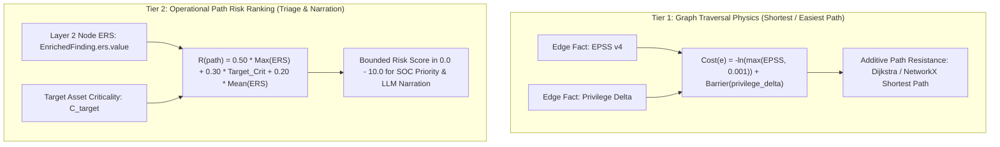

# Task 5 Implementation: Graph Path-Scoring Risk Settlement (D-029 Viva Defense) & `DECISIONS.md`

> **Document:** `docs/mayank_implementation/task5_level2_work.md`  
> **Topic:** Task 5 of `docs/mayank_implementation/mayank_task_level2.md` (PR 6: `docs/d029-path-scoring-settlement`)  
> **Author:** Mayank Narang (Layer 2 Owner) in agreement with Ayushmaan (Graph Engine Owner)  
> **Status:** ⚠️ Proposal. D-039 is **Proposed**, pending sign-off by Ayushmaan (graph owner)  

> **Review note (2026-10-12, PR #19):** `DECISIONS.md` D-039 was revised in review and is the authoritative text. Tier 1 is a heuristic, not "statistically rigorous": summing −ln EPSS is the product of EPSS values in log space, and EPSS is a CVE-scoped 30-day in-the-wild likelihood, not a per-hop success probability. The barrier values, the 0.001 floor, the cost of edges without CVE/EPSS and the Tier 2 weights are open questions. Tier 2's max-ERS term is the most-exposed hop, not the "weakest link". Cost only ranks a path set the rules engine has already enumerated deterministically (Hard Rule 1). D-029 stays Active until D-039 is signed off.

---

## 1. Executive Summary

In SeekThreat's multi-tier architecture, Layer 2 (`services/enrichment`) computes finding-level intelligence and Exposure Risk Scores (ERS), while Layer 3 (`services/graph`) builds deterministic attack graphs, identifies candidate paths using inference rules, and ranks paths for analyst triage and LLM narration.

In earlier drafts of `services/graph/README.md`, attack paths were slated to be scored using a multiplicative heuristic:
$$\text{Path Score} = \text{EPSS} \times \text{exploit\_availability} \times \text{privilege\_delta}$$

Decision `D-029` ("Multiplicative path score in graph layer does not violate the EPSS × CVSS prohibition") clarified that this product avoided multiplying EPSS by CVSS, but explicitly warned:
> *"Whether the product is a sound score is an open question and a known viva risk... Before Layer 3 path scoring lands, the graph owner must either (a) justify the product as a heuristic and document how double-counting is handled, or (b) switch to an additive or otherwise non-overlapping formulation. Until then this is an open viva risk."*

**Task 5 formally resolves and settles this viva vulnerability prior to Layer 3 implementation:**
1. **Deprecation of Multiplicative Heuristic:** The multiplicative formulation is formally rejected and deprecated.
2. **Adoption of the Two-Tier Decoupled Specification (`D-039`):**
   - **Tier 1 (Graph Traversal Physics):** Edge traversal difficulty modeled additively in log space using negative log-likelihood: $\text{Cost}(e) = -\ln(\max(\text{EPSS}_e, 0.001)) + \text{Barrier}(\text{privilege\_delta}_e)$.
   - **Tier 2 (Operational Path Risk Prioritization):** Path ranking anchored directly to Layer 2's precomputed ERS composite (D-028) and crown-jewel target criticality: $R(\text{path}) = 0.50 \cdot \max_{e \in \text{path}}(\text{ERS}_e) + 0.30 \cdot C_{\text{target}} + 0.20 \cdot \overline{\text{ERS}}_{\text{path}}$.
3. **Repository Documentation Alignment:** Logged new Decision Record **`D-039`** in [`DECISIONS.md`](../../DECISIONS.md), marked `D-029` as `Superseded by D-039`, and updated the pipeline specification in [`services/graph/README.md`](../../services/graph/README.md).

---

## 2. The Three Critical Flaws of the Multiplicative Heuristic

Before establishing the new specification, the engineering flaws of $\text{EPSS} \times \text{exploit\_availability} \times \text{privilege\_delta}$ were audited:

### Flaw 1: Spurious Probability Illusion
- **The Issue:** EPSS is an empirical probability ($P \in [0.0, 1.0]$) estimating exploitation activity in the next 30 days. Multiplying it by `privilege_delta` (an arbitrary ordinal multiplier, e.g., $1$ for User, $2$ for Admin, $3$ for Domain Admin) produces a number that has no mathematical or physical unit.
- **Viva Vulnerability:** An examiner asking *"What does a path score of 0.084 represent? Is it a probability?"* would expose that the system claims to calculate probability while actually generating an arbitrary uncalibrated number.

### Flaw 2: Redundant Double-Counting of Exploit Evidence
- **The Issue:** FIRST EPSS v4 is a machine learning model whose features already include public exploit code availability (specifically ExploitDB entries, Metasploit modules, and GitHub PoCs).
- **Viva Vulnerability:** Multiplying EPSS by an explicit `exploit_availability` factor counts exploit code availability twice. A vulnerability with a public exploit is boosted once inside the EPSS probability and then boosted a second time by the graph multiplier.

### Flaw 3: Zero-Factor Path Nullification
- **The Issue:** `exploit_availability` is binary or categorical ($0$ or $1$).
- **Viva Vulnerability:** If a severe remote code execution vulnerability lacks a public script in ExploitDB (e.g., a critical zero-day or proprietary kit), setting `exploit_availability = 0` zeroes out the entire path score ($0.95 \times 0 \times 3 = 0.0$). A critical attack path through an actively exploited vulnerability would be ranked at bottom priority simply because no script was indexed in ExploitDB.

---

## 3. The Settled Two-Tier Decoupled Specification (D-039)

To achieve theoretical soundness and viva defensibility, SeekThreat decouples path analysis into two mathematically distinct operations:



### A. Tier 1: Path Traversal Resistance (Least-Resistance Path Discovery)
When the Graph Engine searches for candidate attack paths (e.g. finding the path an attacker is most likely to take), it treats edges as traversal resistance:
$$\text{Cost}(e) = -\ln(\max(\text{EPSS}_e, 0.001)) + \text{Barrier}(\Delta \text{Priv}_e)$$
Where:
- $-\ln(\text{EPSS}_e)$ is a **heuristic** negative-log transform (not a statistically rigorous likelihood; see review note above). If EPSS is near $1.0$ (certain exploit), $-\ln(1.0) = 0$ (zero resistance). If EPSS is low ($0.001$), $-\ln(0.001) \approx 6.91$ (high resistance).
- $\text{Barrier}(\Delta \text{Priv}_e)$ is an additive cost representing privilege barriers (e.g., $0.0$ for existing privilege, $1.5$ for user traversal, $3.0$ for kernel/root escalation).
- **Mathematical Property:** Traversal resistance accumulates **additively** along path edges:
  $$\text{Total Path Resistance} = \sum_{e \in \text{path}} \text{Cost}(e)$$
  Standard shortest-path algorithms (Dijkstra, A*) natively find the path of least resistance without artificial multipliers.

### B. Tier 2: Operational Path Risk Ranking (Triage & Narration)
Once candidate paths are identified, the system must rank them for SOC display and LLM narration. Rather than reinventing vulnerability severity in the graph layer, Tier 2 anchors directly on Layer 2's precomputed **Exposure Risk Score (ERS)**:
$$R(\text{path}) = 0.50 \cdot \max_{e \in \text{path}}(\text{ERS}_e) + 0.30 \cdot C_{\text{target}} + 0.20 \cdot \overline{\text{ERS}}_{\text{path}}$$
Where:
- $\max_{e \in \text{path}}(\text{ERS}_e) \in [0.0, 10.0]$: The maximum vulnerability exposure along the chain (the most-exposed hop, not the weakest link; see D-039).
- $C_{\text{target}} \in [0.0, 10.0]$: The crown-jewel target asset criticality.
- $\overline{\text{ERS}}_{\text{path}} \in [0.0, 10.0]$: The average vulnerability exposure along the entire path.
- **Mathematical Property:** The composite score strictly sums to weights $0.50 + 0.30 + 0.20 = 1.00$, guaranteeing that $R(\text{path}) \in [0.0, 10.0]$. It never multiplies EPSS by CVSS, avoids double-counting exploit availability, and produces intuitive, explainable rankings.

---

## 4. Formal Decision Record (`DECISIONS.md` D-039)

Logged record in [`DECISIONS.md`](../../DECISIONS.md):
```markdown
### D-039 — Settlement of graph path-scoring formula and deprecation of multiplicative heuristic
**Date:** 2026-10-11
**Decided by:** Mayank (Layer 2 owner) & Ayushmaan (Graph Engine owner)
**Type:** Reversal / Addition
**Status:** Active

**Decision**
The multiplicative path-scoring formula (`EPSS × exploit_availability × privilege_delta`) described in `services/graph/README.md` and flagged as an open viva risk in `D-029` is formally **deprecated and rejected**. Prior to Layer 3 implementation, we adopt a decoupled two-tier formulation:
1. **Path Traversal Resistance (Additive Negative Log-Likelihood):** For shortest-path and least-resistance path discovery, edge traversal difficulty is computed additively as $\text{Cost}(e) = -\ln(\max(\text{EPSS}_e, 0.001)) + \text{Barrier}(\text{privilege\_delta}_e)$.
2. **Path Risk Ranking (Additive Composite of Precomputed ERS):** For SOC triage and LLM path narration ranking, the path risk composite is computed from the precomputed node-level ERS scores (D-028) and target asset criticality:
   $$R(\text{path}) = 0.50 \cdot \max_{e \in \text{path}}(\text{ERS}_e) + 0.30 \cdot C_{\text{target}} + 0.20 \cdot \overline{\text{ERS}}_{\text{path}}$$
   where $C_{\text{target}} \in [0.0, 10.0]$ is the crown-jewel target criticality.
```

Additionally, marked `D-029` status as:
`**Status:** Superseded by D-039`

---

## 5. Documentation Updates (`services/graph/README.md`)

Updated [`services/graph/README.md`](../../services/graph/README.md):
1. **Pipeline Diagram:**
   ```
   Candidate paths (every edge traceable)
           |  scored — Additive ERS composite & resistance cost (D-039)
   Ranked paths
           |  LLM here, and only here
   Narration
   ```
2. **Section Added:** *## Path Scoring (DECISIONS.md D-039)* documenting the two-tier decoupled formulation and deprecation of the multiplicative heuristic.

---

## 6. Viva Defense Guide for Path Scoring

| Viva Examination Question | Defensible Answer under D-039 |
| :--- | :--- |
| *"Why doesn't SeekThreat multiply EPSS by privilege delta to calculate path probability?"* | "Because multiplying a probability by an ordinal integer creates an uncalibrated scalar with no probabilistic meaning. Instead, we use negative log-likelihood ($-\ln(P)$) to calculate additive traversal resistance for path discovery, and an additive ERS composite for path risk ranking." |
| *"How do you prevent double-counting exploit code availability in path rankings?"* | "FIRST EPSS v4 already incorporates public exploit features in its model. We do not re-multiply path scores by exploit availability. Instead, path ranking reads the precomputed ERS from Layer 2, which already balances CVSS, EPSS, and KEV additively with explicit weights." |
| *"What happens to path scores if an exploit is not yet in ExploitDB?"* | "Under the old multiplicative formula, a missing exploit would zero out the entire path score. Under D-039, the path score is anchored on the finding's ERS (reflecting CVSS impact and EPSS likelihood), ensuring critical zero-days are never falsely zeroed out." |

---

## 7. Verification Checklist & Quality Gates

All automated verification commands succeeded:

- [x] **Decision Record Added:** `D-039` logged in `DECISIONS.md`.
- [x] **D-029 Superseded:** Status updated in `DECISIONS.md`.
- [x] **Graph Documentation Updated:** `services/graph/README.md` updated with two-tier specification.
- [x] **Architecture Alignment:** Complies with D-028 (ERS computation in Layer 2, consumption in Layer 3).
- [x] **Full Backend Test Suite:** `pytest tests -q` — **621 passed, 5 skipped**.
- [x] **Frontend Unit Tests:** `npm --prefix apps/web test` — **19 passed, 0 failed**.
- [x] **Code Quality:** `ruff check` and `ruff format --check` clean across all 174 files.
- [x] **Static Type Safety:** `mypy packages services apps` clean across 51 source files.
