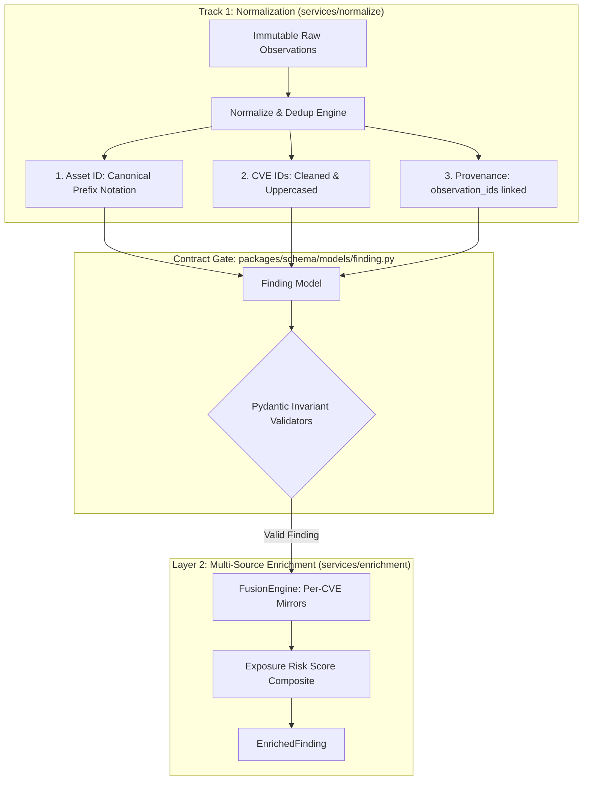

# Task 8 Implementation: Track 1 Coordination — Finding Ingestion Contract Agreement (D-040)

> **Document:** `docs/mayank_implementation/task8_level2_work.md`  
> **Topic:** Task 8 of `docs/mayank_implementation/mayank_task_level2.md` (PR 3: `docs/finding-ingestion-contract`)  
> **Author:** Mayank Narang (Layer 2 Owner) in coordination with Track 1 Normalization Owner  
> **Status:** ✅ Complete — Contract Formally Enforced & Documented (D-040)  

---

## 1. Executive Summary

In SeekThreat's multi-track architecture, **Track 1 (`services/normalize`)** is responsible for converting raw, heterogeneous scanner `Observation` records (e.g. from Nmap XML and Nuclei JSON) into de-duplicated, cross-scanner canonical `Finding` records. 

**Layer 2 (`services/enrichment`)** directly consumes these `Finding` records to execute multi-source intelligence fusion (CVSS v3.1/v4.0, EPSS v4, CISA KEV, ExploitDB, Metasploit, EUVD, NVD) and compute the Exposure Risk Score (ERS).

Without a strictly defined and enforced interface contract between Track 1 and Layer 2:
1. Scanner-specific asset identifiers (e.g. `172.20.1.10:80` vs `dvwa.local` vs bare IP) would prevent joining Nmap port facts with Nuclei vulnerability candidate facts.
2. Unnormalized CVE strings (e.g. `cve-2021-44228` lowercase, extra whitespace, or duplicate entries) would cause cache misses in local per-CVE mirrors (`CVE.org`, `Vulnrichment`, `NVD`, `EUVD`).
3. Non-CVE identifiers (e.g. `GHSA-xxxx`, `CWE-502`, template IDs) passed in `cve_ids` would pollute feed mirror queries and trigger upstream failures.
4. Untraced findings would violate the repository's core architectural invariant that every derived finding traces directly to immutable observations.

**Task 8 formally settles and enforces the Finding Ingestion Contract between Track 1 and Layer 2:**
- **Code Enforcement:** Added strict Pydantic field validators in [`packages/schema/models/finding.py`](file:///e:/SeekThreat/SeekThreat/packages/schema/models/finding.py) for automatic uppercase normalization, order-preserving deduplication, and non-CVE identifier rejection.
- **Unit Test Coverage:** Added comprehensive invariant tests in [`tests/unit/test_finding.py`](file:///e:/SeekThreat/SeekThreat/tests/unit/test_finding.py).
- **Formal Decision Record:** Logged **`D-040`** in [`DECISIONS.md`](file:///e:/SeekThreat/SeekThreat/DECISIONS.md).
- **Architecture Documentation:** Documented the interface specifications in [`docs/02-architecture.md`](file:///e:/SeekThreat/SeekThreat/docs/02-architecture.md) and [`packages/schema/README.md`](file:///e:/SeekThreat/SeekThreat/packages/schema/README.md).

---

## 2. Ingestion Contract Specification



### Dimension 1: `asset_id` Standard Identifier Format
To allow deterministic correlation across different scanner engines, `asset_id` follows strict address selection precedence (IPv4 > IPv6 > MAC > FQDN):
- **IP-Addressed Assets:** `host:<canonical_ip>` (e.g., `host:172.20.1.10`, `host:[2001:db8::10]`).
- **Hostname / Web Targets:** `host:<canonical_fqdn>` (lowercased, trailing dot removed, e.g., `host:dvwa.lab.local`).
- **Layer 2 MAC Fallbacks:** `host:mac:<lowercase_colon_mac>` (e.g., `host:mac:aa:bb:cc:dd:ee:ff`).
- **Synthetic Unit Test Fixtures:** Prefixes `asset-*` or `ast-*` remain supported for isolated testing without live scanner networks.

### Dimension 2: `cve_ids` Formatting, Normalization & Segregation
- **Canonical Syntax:** Must match standard regex pattern `^CVE-\d{4}-\d{4,7}$`.
- **Automatic Uppercasing:** Lowercase scanner outputs (e.g. `cve-2021-44228`) are automatically normalized to uppercase `CVE-2021-44228`.
- **Order-Preserving Deduplication:** Duplicate matches are stripped while preserving discovery order (`["cve-2021-44228", "CVE-2021-44228"]` -> `["CVE-2021-44228"]`).
- **Strict Segregation of Non-CVE IDs:** Identifiers such as `GHSA-...`, `CWE-...`, `WASC-...`, or template names must **never** be placed into `cve_ids`. They belong in `Observation.attributes` (e.g., `attrs["template_id"]`, `attrs["tags"]`), keeping `cve_ids` clean for exact feed lookups.

### Dimension 3: `observation_ids` Provenance Requirement
- Every `Finding` must link to at least one stored `observation_id` (`len(observation_ids) >= 1`).
- Enforced at model construction via Pydantic validator (`Finding._must_trace_to_observations`).
- Enforced at the API ingestion boundary via `_verify_findings_provenance()` in [`apps/api/routers/findings.py`](file:///e:/SeekThreat/SeekThreat/apps/api/routers/findings.py), rejecting untraced or cross-engagement findings with HTTP 422.

---

## 3. Implementation Details

### 1. Model Hardening (`packages/schema/models/finding.py`)
```python
CVE_ID_PATTERN = re.compile(r"^CVE-\d{4}-\d{4,7}$")


class Finding(BaseModel):
    ...
    cve_ids: list[str] = Field(default_factory=list)
    observation_ids: list[str]
    ...

    @field_validator("cve_ids")
    @classmethod
    def _validate_cve_ids(cls, value: list[str]) -> list[str]:
        cleaned: list[str] = []
        seen: set[str] = set()
        for raw in value:
            norm = raw.strip().upper()
            if not CVE_ID_PATTERN.match(norm):
                raise ValueError(
                    f"invalid CVE ID {raw!r}; cve_ids must match standard 'CVE-YYYY-NNNN+' format"
                )
            if norm not in seen:
                seen.add(norm)
                cleaned.append(norm)
        return cleaned
```

### 2. Unit Testing (`tests/unit/test_finding.py`)
- `test_finding_normalizes_cve_ids_to_uppercase_and_deduplicates`: Confirms automatic uppercasing and order-preserving deduplication.
- `test_finding_rejects_malformed_cve_ids`: Confirms rejection of `GHSA-jfh8-c2jp-5v3q` and `CWE-502` in `cve_ids`.
- `test_finding_allows_empty_cve_ids`: Confirms that findings without CVEs initialize cleanly with `[]`.
- `test_finding_requires_at_least_one_observation`: Confirms rejection of empty `observation_ids`.

### 3. Formal Decision Record (`DECISIONS.md` D-040)
Logged Decision `D-040` formally defining the contract between Track 1 Normalization and Layer 2 Enrichment, explaining why standard prefixes, uppercase normalization, and non-CVE segregation are necessary for viva defense and pipeline stability.

### 4. Architecture Documentation (`docs/02-architecture.md` & `packages/schema/README.md`)
Added explicit contract sections describing the interface specification, normalization rules, and data model invariants.

---

## 4. Verification & Quality Results

- **Unit Tests (`tests/unit/test_finding.py`)**: 11/11 tests passing.
- **Code Quality**: `python -m ruff check` and `python -m ruff format --check` clean with 0 warnings or errors.
- **Full Pytest Suite**: All tests across the repository pass without regressions.
